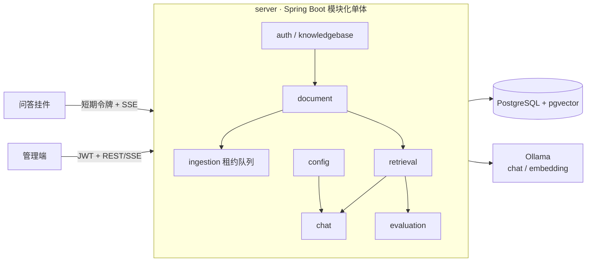

# 知库 RAG

[](https://github.com/suijiafeng/zhiku-rag-prep/actions/workflows/ci.yml)

面向企业内部制度与知识的检索增强问答（RAG）系统：员工就制度提问，回答只依据**有权访问且当前生效**的资料，并给出可核对的来源。

> **状态：开发中，未达到生产可用。** 身份使用本地签发的开发令牌，模型使用本地 Ollama；仓库中只有虚构示例数据，没有真实企业材料，也不调用付费模型。生产接入前仍需企业 IdP、业务决策（见 [ADR-002](docs/adr/002-open-decisions.md)）以及安全、性能和质量评测。

## 设计要点

- **授权先于检索**：每次请求从数据库重读知识库授权，先算出"可访问且生效"的版本集合，再在其中做向量检索；未授权内容不会进入模型、排序或响应。
- **业务效力与索引状态分离**：审批、发布、生效区间与解析/索引状态各自独立；未来生效的新版本可提前入库，不会顶替当前版本。
- **撤回与删除立即生效**：撤权、撤回或删除后，检索、引用、评测证据和依赖它的历史回答（含续问）立即不可见，物理清理在后台进行。
- **引用只做确定性校验**：服务端核对引用编号、来源版本与授权，界面只称"来源信息检查通过"，不宣称回答已被验证正确。
- **流式问答可中止、可对账**：POST + SSE，生成过程中周期重查授权与效力；断线后可按请求编号查询原请求结果，不重复生成。
- **可追溯**：问答、检索调试与评测共用同一检索链路，每次检索保存只含元数据的轨迹（不存问题与正文）。

## 功能

| 模块 | 已实现 |
|---|---|
| 身份与授权 | 本地 HS256 JWT、知识库授权、角色矩阵、管理员授权管理、追加式审计 |
| 文档 | 文档与内容版本、审批/发布/撤回、按时点的效力选择、删除与后台清理 |
| 摄取 | Markdown/TXT 上传校验、数据库租约任务队列（可恢复、续租、退避重试）、切块与向量化 |
| 检索 | 授权范围内精确向量检索、六阶段检索调试、按配置版本再运行与对比 |
| 问答 | SSE 流式回答、引用元数据校验、续问上下文与来源依赖、请求回执与断线查询、历史游标、敏感号码输入拦截、入模字符预算 |
| 反馈与评测 | 点赞/点踩与处理闭环、以原文区间为真值的检索评测、反馈转评测用例、关闭反馈须有回归依据、评测运行面板（见下） |
| 配置 | 知识库配置的候选 → 验证 → 发布 → 回滚，乐观锁防覆盖 |
| 前端 | 管理端 12 个页面；可嵌入问答挂件（短期令牌，不存长期凭据） |

**尚未实现**：生产 IdP/SSO、对话摘要、独立的词法召回与交叉编码器、引用语义验证与回答正确性人工评测、切块参数的在线修改后整库重建、长期 API Key 与 Webhook。评测运行不能切换切块策略；重排只做候选池内的 BM25 与向量分加权。

## 评测面板

管理端「评测中心」在已登录并选中知识库时读写真实接口。未登录时只显示 `GET /api/example-evaluation` 的仓库快照，并标明示例；这个接口不查库。

数据集就是该知识库的评测用例：问题、标签、参考答案、必要事实，以及期望命中的**文档版本 + 原文摘录**（字符区间，不是 chunk id）。可以在页面上新建，也可以 `POST /api/knowledge-bases/{kbId}/eval-cases/import` 导入 JSON 或 CSV。`scripts/example-eval/` 是虚构示例：`dataset.json` 标明 `example: true`，导入后用例来源为 `example:` 开头，界面会标成示例。CSV 表头为 `question,label,expectedAnswer,requiredFacts,documentTitle,versionLabel,quote`，可选 `appliesTo`；多条必要事实用 `|` 分隔。`approve=true` 才会把完整用例批准并纳入运行。

一次运行保存为一行 `eval_run`。可配置的是代码里真实生效的参数：

- 召回 K（1 到 `zhiku.retrieval.max-k`，默认上限 30），也是重排后保留的条数
- 重排：候选池内用字符二元组 BM25 与向量分加权（词法权重 0.65）。`rerankPool` 是送入重排的向量条数，必须介于 K 和 max-k；不填时用 `min(max-k, max(K, K×4))`。没有查询二元组命中时保持向量顺序。这不是交叉编码器
- 入模切块数（1 到 K，且不超过上下文字符预算能放下的块数；不填则用部署默认值并按 K 截断）
- 是否生成回答。生成复用问答的系统提示，不写入会话。没有对话模型时不编造答案，该题记失败原因「未配置对话模型，未生成」
- 评审：`llm`（对话模型，只接受 0 到 1 的 JSON）或 `simulated`（词面规则，测试和离线对照用）

运行会记下当时的切块窗口（部署配置 `chunk-max-chars` / `chunk-overlap`，策略名 `fixed-overlap`）。把切块策略设成别的值会返回 422。评测运行不会整库重建索引。

文档页「编辑切块」调用 `GET/PUT /api/knowledge-bases/{kbId}/documents/{documentId}/versions/{versionId}/chunks`（管理文档权限）。可以改文字、从中间拆开、与下一块合并、删除。保存后用当前 embedding 模型重写该版本的切块向量，检索立刻使用新向量。偏移必须落在规范化原文内；原文文件不改。撤回或已删除的版本不能改。没有 embedding 模型时保存返回 503。

指标（分母不含来源失效和无法映射到当前切块的用例；没测到的值是空，不是 0）：

| 指标 | 定义 |
|---|---|
| Hit@K | 至少一条期望片段被 top-K 切块无间隙完整覆盖的用例比例 |
| Recall@K | 被完整覆盖的期望片段数 / 期望片段总数；另有每题覆盖率的宏平均 |
| MRR | 每题 top-K 中第一块与任一期望片段相交（同一版本、半开区间）的名次的倒数，未相交记 0，再取平均。相交不等于完整覆盖 |
| 忠实度 / 相关性 | 生成后的 0–1 分。LLM 评审看结论是否被送入模型的资料支持、是否回应问题并覆盖必要事实。模拟评审只统计必要事实是否原样出现在回答和资料中 |
| 检索 P50/P95 | 计入分母的检索耗时，最近秩、向上取整 |
| 端到端 P50/P95 | 检索加生成；没有生成耗时的用例不进这个分母 |

Token 只在模型返回用量时保存。Ollama 的非流式 `complete` 读取 `prompt_eval_count` 和 `eval_count`；流式问答路径不记 token。测试用脚本模型默认也不报 token。

面板列出运行、画出该次运行的比例和各题检索延迟、对比两次运行的参数与指标，并给出逐条问题、命中片段、回答、分数和失败原因。低分筛选包括未命中、失败原因，以及低于阈值的忠实度或相关性。没有运行时不画这些图。

## 可靠性设计

这一节按当前代码说明问答在断线、重复提交和来源失效时怎么做。作者：suijiafeng。方便面试时把方案和取舍讲清楚。

**请求编号，不重发。** 每次提问由浏览器生成 `clientRequestId`。管理端把它和知识库、问题一起放进 `sessionStorage`（键 `zhiku.chat.pending`），挂件用另一个键 `zhiku.widget.pending`。两处都不写令牌。SSE 的 `draft` 追加到当前回答。流中断、刷新或网络恢复后，先 `GET /api/chat/requests/{clientRequestId}`。查到已完成且来源仍可见的回答就显示这一次，不再 `POST /api/chat`。挂件令牌只能提问、评价和查询自己的请求，不能拉会话列表。

**回执与内容哈希。** `chat_request` 以 `(enterprise_id, user_id, client_request_id)` 为主键。接受请求时在插入回执；`digest` 是知识库 id、会话 id 和问题的 SHA-256 十六进制，不存问题原文。同一编号、同一摘要返回 `409 REQUEST_DUPLICATE`，不再调用模型。同一编号、不同摘要返回 `409 REQUEST_CONFLICT`。`V26__chat_receipt_completed.sql` 增加 `completed_at`，在保存消息的同一事务里写入，所以“回答已落库”和“回执已完成”一起提交。插入发生在生成之前：这样并发的第二次提交会撞上主键，而不是等模型跑完才发现重复。代价是生成失败或进程退出后，这枚编号不能换一题再用，只能查询原来的结果。

**历史游标。** `GET /api/conversations/{id}/messages/page?limit=&before=` 的游标是 `(created_at, id)`，Base64URL 编码为 `毫秒|uuid`。比较只看到毫秒；同一毫秒按 id 升序决定谁在前一页。`nextCursor` 指向本页最早的一条，下一页严格早于它，因此不会漏掉或重复同一时刻的两条。分页在已经做过来源检查的历史上升成，会话规模按单次对话而不是全库。不把游标当成客户端可改的时间范围。

**文档状态轮询。** `usePollingLoad` 在上一轮 `load` 结束前不发下一轮。期间如果计时器又到了，只记住“还要再跑一次”，结束后补一轮。组件卸载会清掉计时器，进行中的那轮返回后也不再 `setState`。这是为了索引和删除清理的状态，不是问答重试。

**失效来源。** 读历史和构建模型上下文走同一判断：文档已不存在（删除）或版本已撤回（本仓的禁用）时，该轮回答隐藏，问题改成固定提示，引用正文不返回。模型上下文再丢掉隐藏和未完成的轮次，最多保留最近三轮可见问答。续问不会把已撤回的内容当作事实。

**不用 SSE 自动重连。** 解析器忽略 `id` 和 `retry`。EventSource 的自动重连会再次 POST，可能重复计费，也可能在服务端已经保存回答之后再生成一条。所以恢复是显式的 GET。查询失败时保留本地编号，下次刷新再查；用户点停止才会清掉编号。`running` 会短轮询几次，仍然只 GET。

回归脚本：`node --experimental-strip-types scripts/reliability-regression.mjs`。它核对游标样例和“恢复不等于重发”。

## 架构



详见 [docs/architecture.md](docs/architecture.md)。接口与 SSE 协议见 [contracts/openapi.yaml](contracts/openapi.yaml)。

## 技术栈

- **server**：Java 21、Spring Boot 3.5、Spring JDBC、Flyway（V1–V23）、PostgreSQL 16 + pgvector 0.8
- **admin-web**：React 19、TypeScript 5.9、Ant Design 6、Vite 8
- **widget**：React + TypeScript，独立构建，样式隔离
- **测试**：JUnit 5 + Testcontainers（真实 pgvector）、Vitest + Testing Library（happy-dom）

## 快速开始

前置：Java 21、Maven 3.9+、Node 22+、Docker；如需真实问答，另装 [Ollama](https://ollama.com)。

```bash
cp .env.example .env
```

在 `.env` 中填入数据库密码和 `ZHIKU_JWT_SECRET`（可用 `openssl rand -base64 48` 生成）。

```bash
docker compose up -d postgres
```

```bash
cd server && mvn spring-boot:run
```

从 `server/` 目录启动时，`application.yml` 的 `spring.config.import: optional:file:../.env[.properties]` 会读取仓库根目录的 `.env`。按 properties 解析，不要写 `export`。默认监听 `127.0.0.1:8080`。改端口用 `SERVER_PORT=8090`，或 `mvn spring-boot:run -Dspring-boot.run.arguments=--server.port=8090`。

首次启动由 Flyway 建表。可选写入虚构示例知识库与授权：

```bash
docker compose exec -T postgres psql -U zhiku_local -d zhiku < scripts/dev-seed.sql
```

签发开发令牌（仅本地开发使用）：

```bash
node scripts/dev-token.mjs --user 00000000-0000-4000-8000-0000000000a1 --enterprise 00000000-0000-4000-8000-0000000000e1 --roles KB_OPERATOR,EMPLOYEE
```

启动管理端。开发服务器把 `/api` 代理到 `ZHIKU_DEV_PROXY`（默认 `http://127.0.0.1:8080`，可写在仓库根 `.env`）。端口改过时把这个变量改成同一个地址。在登录页粘贴令牌：

```bash
cd admin-web && npm ci && npm run dev
```

**模型**：`.env` 中设 `ZHIKU_CHAT_PROVIDER=ollama` 启用问答，`ZHIKU_EMBEDDING_PROVIDER=ollama` 启用向量化（默认模型 bge-m3，需先 `ollama pull bge-m3`）。未配置 embedding 时文档会排队并说明原因，不会被标记为可检索。

## 测试

```bash
cd server && mvn -B clean verify
```

```bash
cd admin-web && npm ci && npm run check
```

```bash
cd widget && npm ci && npm run check
```

## 目录

```text
server/      后端（auth、knowledgebase、document、ingestion、retrieval、chat、evaluation、config、audit 等业务包）
admin-web/   管理端
widget/      可嵌入问答挂件
contracts/   OpenAPI 与 SSE 协议
scripts/     开发令牌签发、虚构示例种子数据（仅开发用）
docs/        架构、开发约定、ADR、验证记录
```

## 参与开发

本仓库按 [AGENTS.md](AGENTS.md) 约束开发（人与编码助手共用）：

1. 先读 [docs/architecture.md](docs/architecture.md)、[docs/conventions.md](docs/conventions.md)，在 [docs/adr/002-open-decisions.md](docs/adr/002-open-decisions.md) 确认未决事项。
2. 一次只做一个可验收目标，先补失败用例再做最小修改；改协议时同步契约与双端测试。
3. 提交使用 Conventional Commits，一个提交一个目的；未运行的检查不写"通过"。

## 安全与数据

- 身份只取自已验证的令牌，请求体不能携带企业、用户或角色；授权缺失默认拒绝，错误不暴露隐藏资源是否存在。
- 日志、测试与提交中不存真实问答、文档或凭据；测试只用虚构中性数据。
- `scripts/` 中的令牌签发与种子数据仅用于本地开发，生产必须接入企业 IdP。

## 许可

尚未指定开源许可证。

---
> **声明**：本仓库为个人项目，仅供学习交流。
