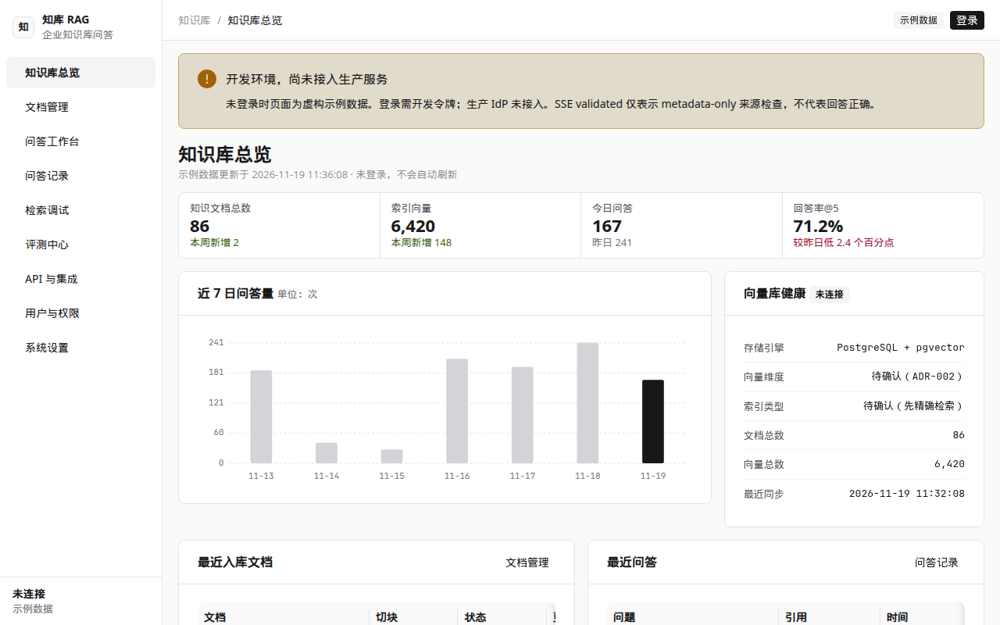
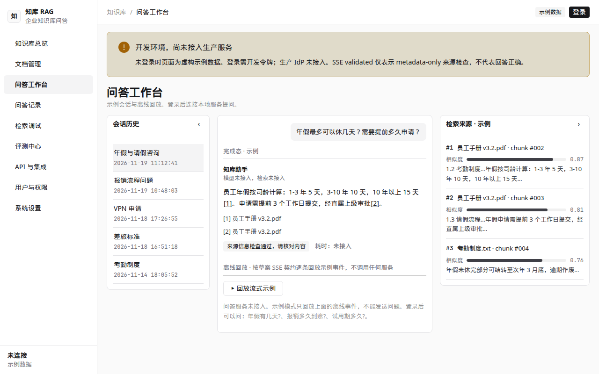
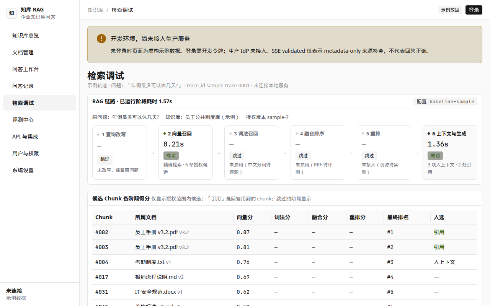
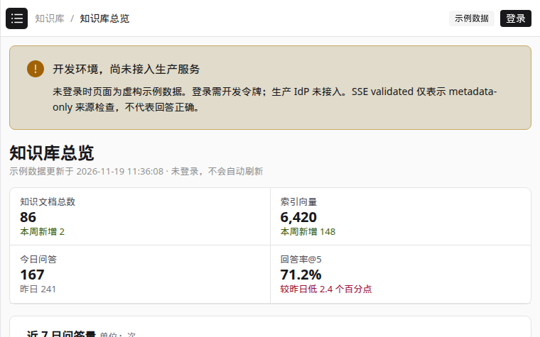

# 知库 RAG

面向企业内部制度的检索增强问答（RAG）。员工就制度提问，回答只依据有权访问且当前生效的资料，并给出来源。

开发中，未达到生产可用。身份是本地签发的开发令牌，模型用本机 Ollama。仓库里只有虚构示例，不调用付费模型。

## 界面

未登录时管理端用虚构示例，页面上标着「示例数据」。下面四张都是这个运行中的界面。

<table>
  <tr>
    <td width="400" valign="top">
      
      <br>总览：指标带，以及带周末低谷的 7 日问答量
    </td>
    <td width="400" valign="top">
      
      <br>问答：回答只带来源，示例模式不能发送
    </td>
  </tr>
  <tr>
    <td width="400" valign="top">
      
      <br>检索调试：同一条链路的分阶段轨迹
    </td>
    <td width="400" valign="top">
      
      <br>窄屏：核心指标收成两列
    </td>
  </tr>
</table>

## 已实现

- 知识库授权与角色：每次请求从数据库重读授权，未授权内容不会进入模型、排序或响应。
- 文档版本：审批、发布、撤回和生效区间与索引状态分开。撤回或删除后，检索、引用和依赖它的历史回答立即不可见。
- 摄取：Markdown / TXT 上传校验，数据库租约队列切块并向量化。
- 问答：SSE 流式回答。追问先改写成独立问题再检索；相关性不够时直接回答"资料不足"，不调用模型。资料中的指令式句子会被屏蔽。引用核对编号、版本和授权，再做一次词面支撑检查；来源面板只列回答实际引用的来源。断线后按请求编号取回原结果，不重复生成。
- 检索：向量 + 字符二元组词法双路召回，RRF 融合，相关性门槛，候选池内轻量重排。chunk 按 Markdown 章节切分，并带「文档标题 › 章节路径」上下文。合格 chunk 多时改走 HNSW 近似检索。
- 检索调试与评测：和问答走同一条检索链路。评测真值是文档版本上的原文区间，不是 chunk id。
- 可嵌入问答挂件：宿主后端换取短期令牌，浏览器不保存长期凭据。
- 管理后台：一键「上传文档」弹窗（选文件 → 新建或新版本 → 可直接批准发布）；授权按姓名 / 邮箱 / 部门搜索本地用户目录镜像（目录外的用户仍可按 ID 授权）；问答输入框固定在底部；路由按页懒加载。

尚未做生产 IdP、对话摘要、引用的语义验证（目前只有词面检查）、交叉编码器重排，以及长期 API Key。

## 技术栈

Java 21 · Spring Boot 3.5 · PostgreSQL 16 + pgvector · React 19 · TypeScript · Ant Design 6

测试是 JUnit 5 + Testcontainers（真实 pgvector）和 Vitest。

## 值得看的地方

- 授权先于检索：先算出「可访问且当前生效」的版本集合，再在其中做精确向量检索。
- 业务效力与索引状态分开：尚未生效的新版本可以先入库，不会顶替当前版本。
- 断线不重发：浏览器带着 `clientRequestId`，服务端用回执去重；恢复时只 GET，不自动重连 SSE。
- 检索轨迹只存元数据，不存问题和正文。

细节在 [docs/architecture.md](docs/architecture.md)、[docs/evaluation.md](docs/evaluation.md) 和 [docs/reliability.md](docs/reliability.md)。

## 本地运行

需要 Java 21、Maven 3.9+、Node.js 22+、Docker。要真实问答再装 [Ollama](https://ollama.com)。

```bash
cp .env.example .env
```

在 `.env` 里填 `POSTGRES_PASSWORD`，以及至少 32 字节的 `ZHIKU_JWT_SECRET`（`openssl rand -base64 48`）。不要写 `export`，这是 properties 文件。

```bash
docker compose up -d postgres
cd server && mvn spring-boot:run
```

从 `server/` 启动时会读取仓库根目录的 `.env`。默认监听 `127.0.0.1:8080`。改端口用 `SERVER_PORT=8090`，或 `mvn spring-boot:run -Dspring-boot.run.arguments=--server.port=8090`。

写入虚构知识库并签发开发令牌（没有默认密码）：

```bash
docker compose exec -T postgres psql -U zhiku_local -d zhiku < scripts/dev-seed.sql
node scripts/dev-token.mjs --user 00000000-0000-4000-8000-0000000000a1 --enterprise 00000000-0000-4000-8000-0000000000e1 --roles KB_OPERATOR,EMPLOYEE
```

```bash
cd admin-web && npm ci && npm run dev
```

把令牌贴进登录页。管理端把 `/api` 代理到 `ZHIKU_DEV_PROXY`，默认 `http://127.0.0.1:8080`。

问答和向量化默认关闭。在 `.env` 设置 `ZHIKU_CHAT_PROVIDER=ollama` 和 `ZHIKU_EMBEDDING_PROVIDER=ollama` 后重启服务。未配置 embedding 时，文档会排队并说明原因，不会被标成可检索。

不装模型也能跑通整条链路：两个 provider 都设成 `mock`，再设 `ZHIKU_RETRIEVAL_MIN_SCORE=0.3`。内置 mock 用字符二元组哈希向量和抽取式回答，只用于本地和测试，回答质量不代表真实模型。

`node scripts/eval-baseline.mjs` 会在服务里新建一个知识库，导入 `scripts/example-eval/` 的虚构文档，输出检索 Hit@1 / MRR、无关问题拒答、追问、注入防护和来源数。结果见 [docs/evaluation-baseline.md](docs/evaluation-baseline.md)。

## 目录

```text
server/      Spring Boot 单体
admin-web/   管理端
widget/      可嵌入问答挂件
contracts/   OpenAPI
docs/        架构、评测与可靠性说明
scripts/     本地令牌、虚构种子数据和评测基线脚本
```

尚未指定开源许可证。个人项目，仅供学习交流。
